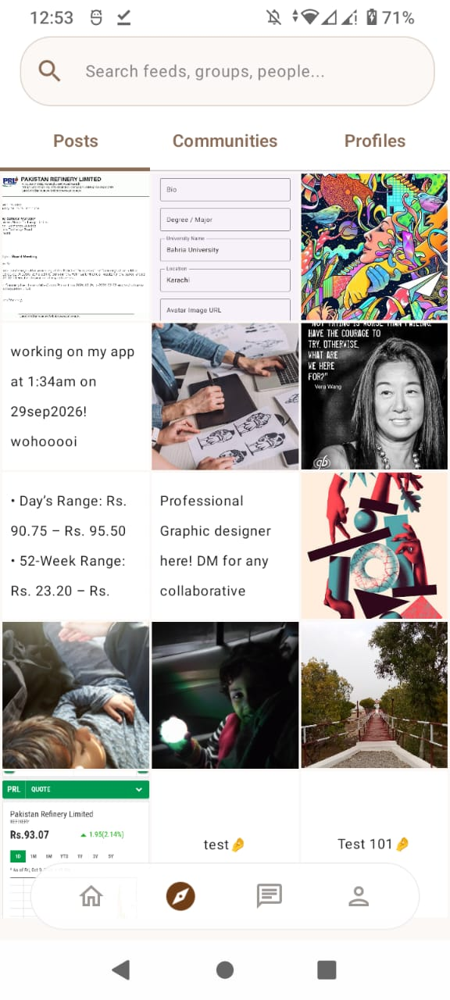
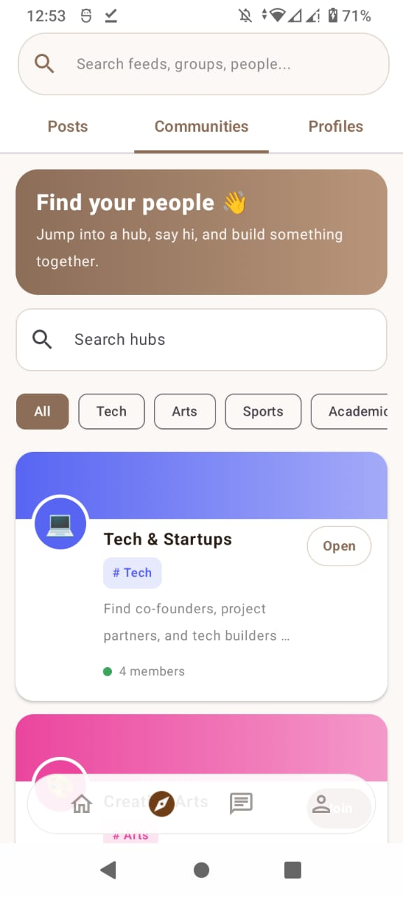
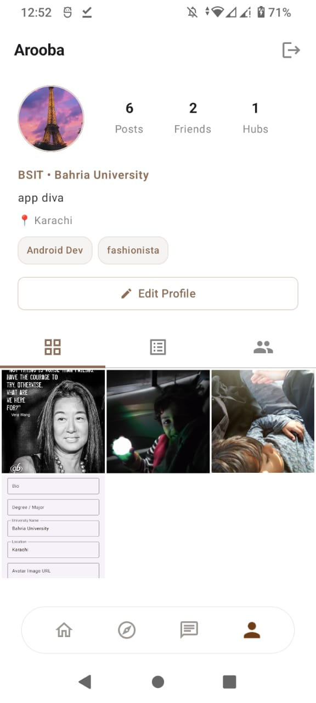
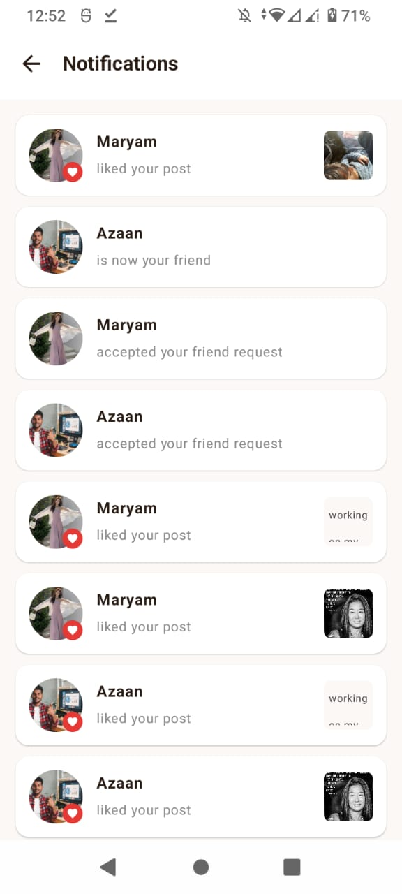

# MindAlike 🧠✨

**Find your people on campus.** MindAlike is an Android social app for university students. Share posts and threads, join interest hubs, chat with friends, and meet people who share your interests, in a space that is kept friendly by AI moderation.


## Screenshots

<p align="center">
  
  
  
  
  
</p>

---

## Features

**Profiles**
- Sign up with your university email, with name, university, degree, location, bio and avatar
- Interest badges (e.g. "Startup Developer", "Creative Lead") shown on your profile
- Post, friend and hub counts, and a friends list you can manage

**Posts & Threads**
- Instagram-style media grid and a text-first thread feed
- Likes and comments
- A "For You" page with a search bar covering posts, communities and people

**Friends**
- Send, cancel, accept and decline friend requests
- Friend and request notifications, plus "X accepted your request" updates

**Communities (Hubs)**
- Discord-style hub cards by category: Tech, Sports, Arts, Academic, Support
- Anyone can browse, search, and join or leave a hub
- Group chat inside each hub, readable before you join

**Direct Messages**
- One-to-one chat with friends, with recent conversations and a friends quick-pick row
- Message button on every profile

**AI Moderation**
- Messages and threads are checked for flirting, scams, and abusive or hateful language
- Strikes lead to temporary mutes (see [AI Moderation](#ai-moderation))

---

## Tech Stack

| Layer | Technology |
|---|---|
| Language | Kotlin |
| UI | Jetpack Compose, Material 3 |
| Navigation | Navigation Compose |
| Backend | [Supabase](https://supabase.com): Auth, Postgres (PostgREST), Row Level Security |
| Serverless | Supabase Edge Functions (Deno / TypeScript) |
| Images | Coil |
| Serialization | kotlinx.serialization |
| Moderation | Local rules, OpenAI moderation endpoint, optional Gemini |

---

## Project Structure

```
com.example.mindalike
├── MainActivity.kt
├── data/                     # Models + Supabase helpers
│   ├── SupabaseClient.kt
│   ├── Profile.kt, Post.kt, PostLike.kt, PostComment.kt, PostFeedItem.kt
│   ├── Community.kt, CommunityMember.kt
│   ├── Friend.kt, FriendRequest.kt, FriendUtils.kt
│   ├── Message.kt, MessageActions.kt, ChatUtils.kt
│   ├── AppNotification.kt
│   └── ModerationLog.kt
├── ui/
│   ├── components/           # ChatComponents, PostCard, MindAlikeLogo
│   ├── navigation/           # AppNavGraph, Screen
│   ├── screens/
│   │   ├── AuthScreen.kt, SplashScreen.kt, MainScreen.kt, Home.kt
│   │   ├── CreatePostScreen.kt, NotificationsScreen.kt
│   │   ├── DirectMessagesScreen.kt
│   │   ├── community/        # CommunitiesTab, CommunityChatScreen
│   │   ├── fyp/              # FypScreen, FypFeedScreen, FypViewModel
│   │   └── profile/          # ProfileScreen, ProfileFeedScreen, EditProfileBottomSheet
│   └── theme/
└── util/
    └── AiContentModerator.kt
```

---

## Database

Core tables (see `supabase/schema.sql`):

| Table | Purpose |
|---|---|
| `profiles` | User profile linked to Supabase Auth, with badges, strike count and mute state |
| `communities`, `community_members` | Interest hubs and memberships (member count kept by a trigger) |
| `posts` | Media posts and text threads |
| `post_likes`, `post_comments` | Engagement |
| `friend_requests`, `friends` | Friend graph |
| `messages` | Direct messages and community chat in one table |
| `notifications` | Notification records |
| `moderation_logs` | Short log of removed content |

All tables use Row Level Security.

---

## Getting Started

### Prerequisites
- A recent Android Studio
- A free [Supabase](https://supabase.com) project
- Optional, for AI moderation: an OpenAI API key (the moderation endpoint is free) and/or a Gemini API key

### 1. Clone
```bash
git clone https://github.com/aroobaaaaaaaa/MindAlike.git
cd MindAlike
```

### 2. Set up Supabase
1. Create a project and open the **SQL editor**.
2. Run `supabase/schema.sql` to create the tables, triggers and policies.
3. In **Authentication**, configure email sign-in the way you want it.

### 3. Add your keys
Open `data/SupabaseClient.kt` and set your project URL and **anon** key.

> ⚠️ Use the anon key only, **never** the service-role key in the app. Don't commit real keys to a public repo. Keep them in `local.properties` or `BuildConfig` instead.

### 4. Run
Open the project in Android Studio, let Gradle sync, and run on an emulator or device.

---

## AI Moderation

Every new message (DM or community) and thread goes through moderation **before others can see it**:

1. A new row is inserted as `pending`. Only the sender can see it.
2. A database trigger calls the `moderate-content` Edge Function.
3. The function checks the text in layers, cheapest first:
   - **Local rules**: a Roman-Urdu abuse word list and obvious scam phrases (OTP requests, "double your money" and similar)
   - **OpenAI moderation** (free endpoint): hate, harassment, sexual content, violence
   - **Gemini** (optional): only for messages with flirting, scam or contact-sharing signals
4. If it passes, it becomes `approved` and shows up for everyone. If not, it is **deleted**, a short log line is saved, and the sender gets a strike.
5. Strikes add up to temporary mutes: 3 strikes mutes for 1 hour, 5 for 24 hours, and 8 for 7 days.

Design notes:
- **Self-harm is never blocked.** People in distress shouldn't have their messages deleted or be struck.
- **Fails open.** If an AI service is down, rules still apply and chat keeps working. A safety job approves anything still pending after 3 minutes.
- **Free-tier friendly.** Logs keep at most 300 characters and are pruned after 30 days, and removed content is deleted.

### Deploying moderation
Deploy the function **before** running the SQL.

```bash
# 1. Deploy the function (it checks its own webhook secret)
supabase functions deploy moderate-content --no-verify-jwt

# 2. Set secrets
supabase secrets set MODERATION_WEBHOOK_SECRET=<long-random-string>
supabase secrets set OPENAI_API_KEY=<your-openai-key>
supabase secrets set GEMINI_API_KEY=<optional>
supabase secrets set GEMINI_MODEL=<optional, a free Flash-Lite model>
```

Then edit `supabase/moderation_setup.sql`: replace `YOUR_PROJECT_REF` and `YOUR_WEBHOOK_SECRET` (the same value as above), and run it in the SQL editor.

---

## Built for the Free Tier

MindAlike is designed to stay free to run on Supabase's free plan (500 MB database, 1 GB file storage, 500K Edge Function calls per month):

- Chat is plain text, so the database grows slowly
- Moderation logs are truncated and auto-pruned
- Rejected content is deleted
- Local rules and the free OpenAI endpoint handle most checks, with Gemini only as an optional extra

---

## Roadmap

- [ ] Supabase Realtime for instant chat (currently short polling)
- [ ] Image moderation
- [ ] Report and block users
- [ ] Moderation feedback when creating threads
- [ ] Push notifications
- [ ] Read receipts and typing indicators

---

## Contributing

Pull requests are welcome. For larger changes, please open an issue first to discuss what you'd like to change.
